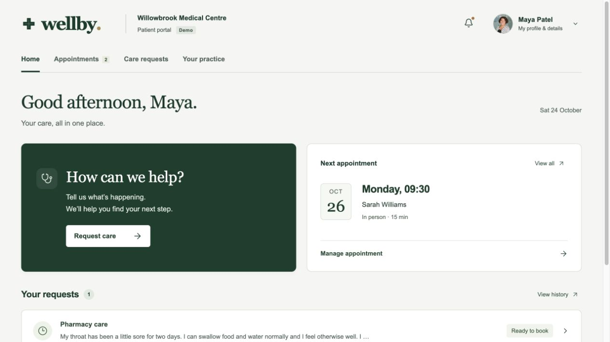

# Wellby

### A clearer route from a health concern to an appointment.

Wellby is a working patient-portal demo built for the Mubit hackathon. A patient describes a concern, reviews their details, receives a suggested care pathway, and chooses an appointment with the appropriate fictional care team. The practice workspace brings requests, schedules and model comparisons together.



**This is a fictional demonstration, not a medical service.** Patients, records and appointment availability are synthetic. Urgent-care service locations come from attributed public directories. Wellby does not diagnose conditions, contact the NHS or create real healthcare appointments.

## Try the patient journey

1. Sign in with **Continue as Maya Patel**.
2. Choose **Request care** and describe a fictional concern.
3. Check the health details and review the summary before submitting.
4. Read the suggested next step. Routine pathways offer available demo appointments; urgent and uncertain cases follow escalation or review flows.
5. Choose a time and confirm. The appointment appears in your account, with rescheduling, cancellation and calendar download.

The **Ask Wellby** chat offers another entry point: general health information, an editable conversation about symptoms, a care summary to confirm, and appointment selection. Its permanent **Not medical advice** notice remains visible.

## Run locally

Use **Node.js 24 LTS** and npm. The server uses the built-in `node:sqlite` module.

```sh
npm ci
cp .env.example .env
npm run dev
```

Open **http://127.0.0.1:4174**. The first start creates the local fictional practice, demo account and appointment availability automatically. No dataset download is needed.

```sh
npm test       # Offline integrity and workflow tests; no paid model calls
npm run build # TypeScript check and production build
npm start     # Serve the production build locally
```

Demo account: `maya@wellby.demo` / `Wellby2026!`. These are public demo credentials, not production credentials.

### Configure model access

All keys stay on the server in `.env`; none belong in client code or Git.

| Variable            | Purpose                                                                  |
| ------------------- | ------------------------------------------------------------------------ |
| `MUBIT_API_KEY`     | Enables care navigation, support chat and the Mubit comparison endpoint. |
| `MUBIT_MODEL`       | Care-navigation teacher model; defaults to `claude-haiku-4-5`.           |
| `ANTHROPIC_API_KEY` | Direct-provider side of the Haiku comparison.                            |
| `COMPARISON_MODEL`  | Default model for new comparison runs; `claude-haiku-4-5`.               |
| `OPENAI_API_KEY`    | Optional, for direct OpenAI comparisons when a GPT model is configured.  |
| `MUBIT_CONSOLE_URL` | Optional link to your own Mubit task or project.                         |
| `PORT`              | Local port; defaults to `4174`.                                          |

Without keys, the portal and local appointment-management screens still run. AI features show their unavailable state. Inference, example-recording and comparison controls make real API calls and can incur charges; starting the application does not start a training or evaluation batch.

## What Mubit does here

The repeated task is **primary-care navigation**: turn a structured symptom intake into one of seven pathways—pharmacy, GP, nurse, physiotherapy, urgent care, emergency services or practice review.

- Synthetic historical-style inputs are sent with a consistent Haiku model, instruction and response contract.
- Training calls use Mubit's full recording mode. Mubit reviews eligible provider answers and can train a task-specific adapter from retained examples.
- Patient interactions default to metadata-only recording, which Mubit does not list in Requests. For fictional portal care-routing requests, set `MUBIT_RECORD_DEMO_REQUESTS=true` to store input/output and make those calls visible and eligible for training. General chat replies and endpoint comparisons remain metadata-only; evaluation content is excluded from training regardless of this setting.
- Normal API requests use Mubit's automatic routing. The app does not invent an adapter-selection header or assume every gateway response was served by an adapter.
- A separate conversational prompt handles chat replies. When a care summary is confirmed, the chat calls the same navigation function as the main symptom flow.

Saving a staff correction locally does **not** retrain a model. Recorded calls, retained examples, trained versions and live adapter serving are tracked as distinct stages. See [architecture and data flow](docs/ARCHITECTURE.md).

### Training and evaluation evidence

At the last console check, **24 October 2026, 12:41 BST**, our Haiku navigation task showed:

| Evidence                                      | Observed result                   |
| --------------------------------------------- | --------------------------------- |
| Task calls                                    | 203                               |
| Retained examples                             | 94                                |
| Additional calls sent for review              | 95                                |
| Additional calls over that day's review limit | 3                                 |
| Existing adapter v1                           | 77.8% on 18 console-scored cases  |
| Console quality target                        | 85%                               |
| Serving                                       | Not ready; no linked request path |

This is a dated observation, not a promise of current performance. **We have not demonstrated 90% accuracy, clinical effectiveness or production adapter serving.** A fresh checkout has its own empty local run history; private session databases and receipts are not committed.

The code includes 100 original synthetic training cases, 98 additional training cases, 20 original reserved evaluation cases, and a separate 100-case comparison set. Illustrative expected routes are kept out of model inputs. They are not clinician-validated ground truth.

## Compare the two endpoints

Open **Practice workspace → Model comparison**. Create a run and start with one case.

- **Direct Anthropic:** Haiku called with the direct provider key.
- **Mubit automatic routing:** the same Haiku request sent through the Mubit gateway.
- Inspect actual responses, elapsed times, returned models, usage and request receipts.
- Failures remain in accuracy denominators. Unknown costs stay unknown. A Mubit receipt alone does not prove adapter serving.
- Runs are saved independently; switching the default model does not relabel historical results.

For a demo, use the same held-out cases on both endpoints and show the actual serving evidence. Avoid presenting gateway results as a trained-model comparison unless that execution is verified.

## Project layout

```text
src/       React patient portal, care flow, chat and practice workspace
server/    Express API, model clients, SQLite storage and offline tests
shared/    Types, pathways and comparison contracts
public/    Static assets and photography credits
docs/      Architecture and demo-video storyboard
```

Local account details, conversations, requests, bookings, model receipts and results live in `.wellby/practice.sqlite`. The entire `.wellby/` directory is excluded from Git. Existing data is retained across restarts.

## Scope and limitations

This is a locally hosted hackathon application. Sign-in separates demo accounts, but the practice workspace is not a production staff-access system. Email, password reset, real clinical integrations and real appointment systems are not connected. Safety escalation is part of the demonstration and is not a clinically validated triage system.

## Demo and credits

- [93-second full-product demo and PDF deck](demo/README.md)
- [Original product-film storyboard](docs/DEMO_VIDEO.md)
- [Architecture and Mubit integration](docs/ARCHITECTURE.md)
- [Stock-photography credits](public/photo-credits.txt). Portraits illustrate fictional identities and do not imply endorsement.
- [Mubit: first adapter](https://docs.mubit.ai/guides/first-adapter)
- [Mubit: Anthropic integration](https://docs.mubit.ai/guides/connect-anthropic)

Built with React, TypeScript, Vite, Express, SQLite, Radix UI and Lucide.

## Urgent care waiting times

The patient home includes a UK postcode urgent-care finder with sourced service locations in all four nations. Mubit waiting-time forecasts are available for the three centres covered by the historical cohort; other locations show service information without inventing a wait. See [setup, data and verified results](docs/URGENT-CARE.md). The dedicated task has 500 recorded calls awaiting Mubit review; 100 evaluation cases remain separate. **Practice workspace → Urgent care** displays training progress, held-out evaluation metrics, request receipts and explicit test controls.
