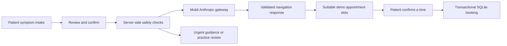

# Architecture

## Patient request

`server/navigation.ts` defines the stable task instructions, validates input/output and applies local safety handling. `server/index.ts` owns requests and available appointment slots. Confirmed bookings use database uniqueness constraints for both slot and request, and availability is checked again at confirmation.

`server/auth.ts` provides local demo accounts, password hashing and sessions. Request, appointment and chat access are scoped to the signed-in patient. This does not implement a production clinical staff-permissions model.

## Support chat

`server/support-chat.ts` calls Haiku through Mubit with a separate conversational prompt. The model returns text and, when sufficient context exists, a structured draft intake. It cannot write appointments through generated text.

A user confirms the draft to invoke the existing navigation function. The UI then queries real availability from this demo's slot store, and the user confirms a selected time. The server rejects stale drafts after subsequent user messages, checks ownership, and avoids duplicate bookings. Conversations persist per patient.

The chat shows a bold non-medical-advice notice, limits message size and request rate, validates model output, and keeps request receipts. These implementation checks are not clinical validation.

## Learning

`server/data.ts` supplies the original synthetic history and reserved evaluation cases. `server/training-expansion.ts` adds 98 varied fictional training examples. `server/submit-training.ts` is an explicit, bounded submission runner with persisted attempts, deduplication and no automatic retries.

Training requests record provider answers through Mubit. Local expected labels are used for illustrative analysis and are not sent as corrected answers to the provider. Acceptance, adapter training and deployment happen in Mubit and must be verified there. More calls do not guarantee higher quality.

Patient requests exclude request/response content by default. `MUBIT_RECORD_DEMO_REQUESTS=true` explicitly enables full recording for fictional portal care-routing calls so they appear in Mubit Requests and become eligible for training. General chat replies and evaluations keep their separate metadata-only/off policy. The gateway's routing decision is separate from the requested teacher model name.

## Comparison

`server/endpoint-comparison.ts` sends matching bodies to the direct provider and the Mubit gateway. Haiku uses the Anthropic message protocol; GPT runs use the OpenAI-compatible protocol. Each run retains its selected model and independent results.

The independent 100-case set lives in `server/benchmark-data.ts`. Input/prompt hashes, actual usage, response timing and receipts support traceability. Failed calls count as failures. Unreported monetary costs are not fabricated. Gateway provenance is never equated automatically with verified adapter execution.

The earlier import-based benchmark remains available for historical evidence; its results are not overwritten by endpoint runs.

## Storage and public repository

The application creates its SQLite database locally on first start. No session database, uploaded patient image, API secret or private inference receipt is shipped in this repository. Static demo portraits and authored fictional example inputs are included. Do not expose this local demo as a production medical service.
